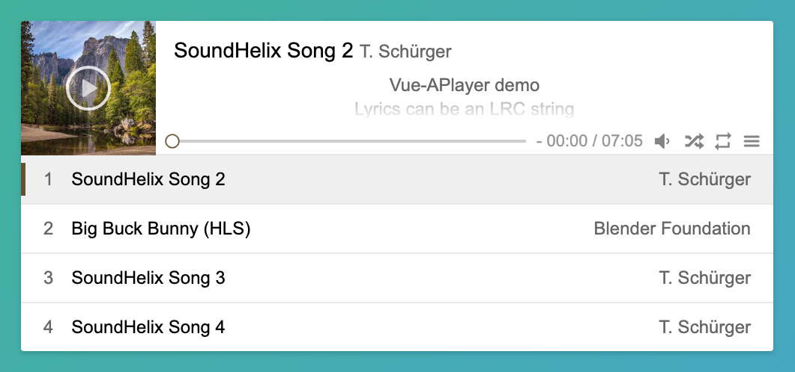

<p align="center">
  
</p>

<h1 align="center">vue3-aplayer</h1>

<p align="center">
  A clean, lightweight music player component for Vue 3.
</p>

<p align="center">
  <a href="https://github.com/fdddf/vue3-aplayer/actions/workflows/ci.yml"></a>
  <a href="https://www.npmjs.com/package/vue3-aplayer"></a>
  <a href="https://www.npmjs.com/package/vue3-aplayer"></a>
  <a href="LICENSE"></a>
</p>

<p align="center">
  <a href="https://vue3-aplayer.zixi.org/"><strong>Live demo</strong></a> ·
  <a href="docs/README.md">Documentation</a> ·
  <a href="docs/README.zh-CN.md">中文文档</a> ·
  <a href="CHANGELOG.md">Changelog</a>
</p>



## Features

- Clean UI in the style of [APlayer](https://github.com/MoePlayer/APlayer)
- Playlist with shuffle and repeat modes
- Scrolling lyrics from an LRC string or a `.lrc` URL
- Custom theme color, per song or picked from the cover image
- Mini mode, and float mode where the player can be dragged anywhere on the page
- Mutex playback: starting one player pauses the others
- HLS (`.m3u8`) streams via hls.js
- `v-model` for the current song, volume, mute, shuffle and repeat
- Emits every native `<audio>` media event
- No runtime dependencies, about 10 KB of JS and 5 KB of CSS gzipped

## Installation

```sh
npm i vue3-aplayer
```

Or use it from a CDN, which exposes the `VueAPlayer` global:

```html
<link rel="stylesheet" href="https://cdn.jsdelivr.net/npm/vue3-aplayer/dist/vue3-aplayer.css">
<script src="https://cdn.jsdelivr.net/npm/vue@3/dist/vue.global.prod.js"></script>
<script src="https://cdn.jsdelivr.net/npm/vue3-aplayer"></script>
```

## Quick start

Register the component globally:

```js
import { createApp } from 'vue'
import VueAPlayer from 'vue3-aplayer'
import 'vue3-aplayer/style.css'
import App from './App.vue'

createApp(App).use(VueAPlayer).mount('#app')
```

Then use `<aplayer>` in any template:

```vue
<template>
  <aplayer :music="song" :list="playlist" show-lrc />
</template>

<script setup>
const playlist = [
  {
    title: 'SoundHelix Song 1',
    artist: 'T. Schürger',
    src: 'https://www.soundhelix.com/examples/mp3/SoundHelix-Song-1.mp3',
    pic: 'https://picsum.photos/id/1025/300/300',
    lrc: '[00:00.00]First line\n[00:05.00]Second line',
  },
  {
    title: 'SoundHelix Song 2',
    artist: 'T. Schürger',
    src: 'https://www.soundhelix.com/examples/mp3/SoundHelix-Song-2.mp3',
    pic: 'https://picsum.photos/id/1043/300/300',
  },
]
const song = playlist[0]
</script>
```

You can also register it locally in a single component:

```vue
<script setup>
import Aplayer from 'vue3-aplayer'
import 'vue3-aplayer/style.css'
</script>

<template>
  <Aplayer :music="{ title: 'Song', artist: 'Artist', src: '/song.mp3' }" />
</template>
```

## Props

| Prop | Type | Default | Description |
| ---- | ---- | ------- | ----------- |
| `music` | Object | *required* | The current song: `{ src, title, artist, pic, lrc, theme }`. Supports `v-model:music`. |
| `list` | Array | `[]` | Playlist. The list panel is shown when it is not empty. |
| `mini` | Boolean | `false` | Mini mode: only the cover and play button. |
| `float` | Boolean | `false` | Float mode: drag the player by its cover. Disabled on mobile. |
| `showLrc` | Boolean | `false` | Show scrolling lyrics. |
| `theme` | String | `'#41b883'` | Theme color, or `'pic'` to pick it from the cover image. |
| `shuffle` | Boolean | `false` | Shuffle the playlist. Supports `v-model:shuffle`. |
| `repeat` | String | `'no-repeat'` | `'repeat-one'`, `'repeat-all'` or `'no-repeat'`. Supports `v-model:repeat`. |
| `mutex` | Boolean | `true` | Pause other players when this one starts playing. |
| `listFolded` | Boolean | `false` | Start with the playlist folded. |
| `listMaxHeight` | String | — | Max height of the playlist, e.g. `'200px'`. |
| `autoplay` | Boolean | `false` | Start playing when mounted. Ignored on mobile, and subject to the browser's autoplay policy. |
| `controls` | Boolean | `false` | Show the native audio controls. |
| `volume` | Number | `0.8` | Volume from 0 to 1. Supports `v-model:volume`. |
| `muted` | Boolean | `false` | Mute the player. Supports `v-model:muted`. |
| `preload` | String | — | `'none'`, `'metadata'` or `'auto'`. |

Events, slots and every song field are covered in the [full documentation](docs/README.md).

## Optional features

### HLS streams

Safari plays `.m3u8` natively. Other browsers need [hls.js](https://github.com/video-dev/hls.js):

```js
import Hls from 'hls.js'

app.use(VueAPlayer, { hls: Hls })
```

### Theme color from the cover image

Set `theme="pic"` on the player, or `theme: 'pic'` on a song, and provide [color-thief](https://github.com/lokesh/color-thief). Version 2.x and 3.x both work. The cover must be served with CORS headers.

```js
import * as ColorThief from 'colorthief'

app.use(VueAPlayer, { colorThief: ColorThief })
```

With CDN builds, loading either library as a `<script>` (`window.Hls`, `window.ColorThief`) is enough.

## Upgrading from 1.x

Version 2.0 rebuilt the package with Vite. The main changes are:

- Import the stylesheet yourself with `import 'vue3-aplayer/style.css'`.
- Pass hls.js and color-thief through `app.use(VueAPlayer, { hls, colorThief })`, or load them as globals.
- Replace `.sync` with `v-model:<prop>`.
- Only `dist/` is published, so imports from `vue3-aplayer/src/...` no longer work.

See the [changelog](CHANGELOG.md) for the full list, including the bug fixes.

## Development

```sh
npm install
npm run dev         # demo page with hot reload at http://localhost:3000
npm test            # unit tests (Vitest)
npm run lint        # ESLint
npm run build       # library → dist/
npm run build:demo  # demo page → demo/
```

- Development happens on `main`. Pull requests are welcome, so please run `npm run lint && npm test` first.
- Every push to `main` deploys the [demo](https://vue3-aplayer.zixi.org/).
- Publishing a GitHub release publishes the package to npm.

## Credits

vue3-aplayer is a Vue 3 fork of [Vue-APlayer](https://github.com/SevenOutman/vue-aplayer) by [@SevenOutman](https://github.com/SevenOutman), which is in turn based on [APlayer](https://github.com/MoePlayer/APlayer) by [@DIYgod](https://github.com/DIYgod). The demo uses music from [SoundHelix](https://www.soundhelix.com), covers from [Lorem Picsum](https://picsum.photos) and an HLS test stream from [Mux](https://test-streams.mux.dev).

## License

[MIT](LICENSE). Copyright © 2016-present Shenghao "Doma" Lei.
